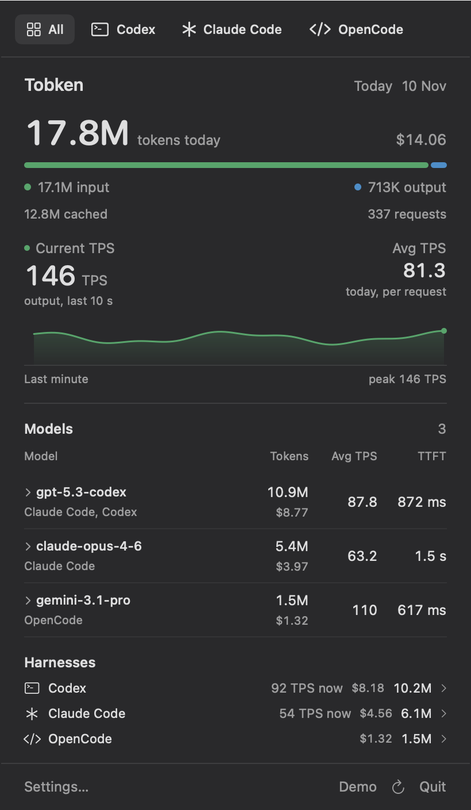

# Tobken

A native macOS menu bar app for tokens today, TPS, and TTFT across your local
coding tools. The status bar always shows the global total. Click it for model
and harness breakdowns; select a harness to filter the menu.



## Run

Requires macOS 14 or later and a Swift 6 toolchain (Xcode or Command Line Tools).

```sh
Scripts/build.sh
open dist/Tobken.app
```

The app has no Dock icon. Look for the token count in the menu bar. It reads
supported logs automatically; Settings lets you add other transcript locations.
To launch at login, add `Tobken.app` to macOS System Settings → General → Login
Items. The local build is ad hoc signed.

```sh
Scripts/test.sh
dist/Tobken.app/Contents/MacOS/Tobken --verify
dist/Tobken.app/Contents/MacOS/Tobken --demo
dist/Tobken.app/Contents/MacOS/Tobken --render-preview /tmp/tobken-preview
dist/Tobken.app/Contents/MacOS/Tobken --ui-smoke-test /tmp/tobken-ui-smoke
```

`--demo` and previews use synthetic data. `--verify` creates isolated transcripts
and checks the production background reader through seed, append, and restart.
The UI smoke test requires an active macOS desktop session and uses demo data.

## What the numbers mean

- **Tokens today:** input + output since local midnight, across every detected
  supported harness and model. Cached input and reasoning are already included
  in input/output; they are not added twice. Requests count when their usage is
  logged, so an unfinished request may appear later. Missing model names still
  contribute to totals.
- **Current TPS:** new output tokens observed in logs in the last five seconds,
  divided by five, summed across all tools and models. Quiet seconds count as
  zero; after five seconds without new output the reading is `0`, even if a
  request is still marked active. Input never increases TPS. Startup history,
  duplicate records and finalizing an unchanged usage count do not add output.
  Tools that report usage only at completion produce bursts; this measures
  observed log throughput, not individual token emission or predicted speed.
  A dash means the monitor is starting or has no supported sources.
  The graph records that same TPS reading over 60 seconds, with the latest
  reading at the right-hand dot. It keeps past readings fixed and leaves gaps
  for unavailable readings. The labeled scale stays fixed during activity,
  grows for new peaks, and resets after a full idle minute. It fills as the
  app observes activity; it does not reconstruct a history on startup.
- **TPS in model rows / Avg TPS:** today's output divided by summed timed request
  durations, including TTFT. It is weighted by duration, not an average of the
  displayed per-request rates. This includes pauses within requests and excludes
  idle time between them. Intervals under 500 ms are widened to 500 ms;
  missing or invalid intervals do not contribute to speed.
- **TTFT:** approximate p50 from the first content timestamp a harness writes.
  Some harnesses do not record it; `—` means unavailable. Expand a model for
  current TPS, sample counts, response duration p50, and TTFT p95 (20+ samples).
  Percentiles use the collector's logarithmic latency histogram.

This first version reads local logs. It does not capture browser chat, remote
machines, or every arbitrary API client. Cursor is not supported yet. It starts
no proxy, account login, pricing fetch, telemetry, or remote listener. Your
transcripts are not uploaded.

## Resource use

File notifications trigger incremental reads. Snapshots publish at most once a
second during output activity and stop when the five-second window reaches
zero. A ten-second discovery check catches missed events and new sources.
Recent files have at most 32 transcript watchers plus OpenCode database/WAL
watchers. Unchanged menu-bar text is not redrawn. The menu and Settings views
are created when opened and released when closed; no hidden graph animates.
The graph fills known quiet intervals with zeros when activity resumes or the
menu opens, without an idle drawing timer.

See [resource measurements](docs/resource-use.md) for measured CPU/memory costs
and the repeatable sampling command. Startup still reads today's history;
memory also depends on the number of requests and sessions being tracked.

## Supported harnesses

Codex, Claude Code, Claude Desktop's local agent logs, DeepSeek Harness,
OpenCode, Gemini CLI, Pi, oh-my-pi, Antigravity, WorkBuddy, WorkBuddy AI, ZCode,
Kimi, Grok Build, OpenClaw, Hermes, Factory Droid, and Devin CLI. Actual coverage
depends on the installed tool writing a supported transcript format. Reader
warnings are shown in the menu; hover for details.

## Code and provenance

- `Sources/Tobken`: AppKit status item and SwiftUI dropdown/settings.
- `Sources/TobkenCore`: presentation, grouping, formatting, synthetic fixtures,
  and an end-to-end verifier.
- `Vendor/AgentSpeed`: pinned MIT collector, request ledger, and live-rate
  engine. Small local changes expose model statistics from the existing ledger;
  see [provenance](Vendor/AgentSpeed/UPSTREAM.md).
- `Vendor/CodexBar`: MIT license and provenance for reused layout constants.
  The compact native UI follows CodexBar's visual style; this is a separate
  application, not a full CodexBar fork.

The package uses no remote Swift dependencies. App packaging includes upstream
licenses. The full collector is vendored to keep source compatibility; its
unused networking and reporting facilities are not started by Tobken.

## Investigation

- [Full investigation](research/reports/investigation.md)
- [Pinned source inventory](research/reports/source-evidence.json)
- [Research verification](research/reports/verification.md)
- [Initial app verification](docs/verification.md)

Reference checkouts live under the ignored `research/upstream/` directory.
All needed application source is included in `Vendor/`; those checkouts are not
required to build.
