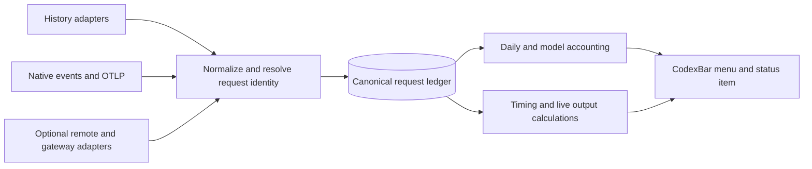

# Cross-harness token meter investigation

Investigated 2026-11-10. Findings below distinguish inspected implementation,
documented interfaces, and proposed behavior.

**Recommendation: fork CodexBar for its native interface, add a global activity
view and a single request ledger, and reuse selected accounting and performance
adapters from Syrtis/tokscale and Agent Speed. None of the inspected applications
currently delivers the complete requested combination.** Daily totals are
straightforward for supported sources. Accurate live output speed and first-token
latency depend on what each source exposes.

## What the product should do

The menu bar should answer two questions without opening anything:

```text
[icon] 18.4M today · 146 out/s
```

Those are illustrative values. The first value includes all observed usage today,
across models and harnesses. The second counts output generation only, summed
across concurrent requests. A two-line compact layout can be optional.

Clicking should open the familiar CodexBar menu: the same native material,
typography, spacing, separators, selection treatment, and footer. The initial
selection should be All. Put today's input/output/cache breakdown and live output
at the top, then model rows with throughput and latency. Keep harnesses available
as a filter and drill-down. Choosing a filter should not silently change the
global number in the menu bar.

The technical constraint is observability: a menu app can count requests only
when logs, an API, or telemetry expose them. “Regardless of harness or model” is
achievable as the aggregation policy; it cannot mean guaranteed visibility into
every opaque application or remote account without an integration.

## Projects and source versions

The checkouts preserve these exact revisions. Links point to immutable source.

| Project | Inspected revision | Relevant role |
|---|---|---|
| [steipete/CodexBar](https://github.com/steipete/CodexBar/tree/7447bc77c2497323d9c41e40164ce705533493c8) | `7447bc77c249` | Desired interface, menu renderer, existing historical performance |
| [Nanako0129/syrtis](https://github.com/Nanako0129/syrtis/tree/fbb8494c45b9bde65592a2de7e9629630d790c43) | `fbb8494c45b9` | Cross-harness menu bar accounting and Rust/Swift integration |
| [Syrtis shared core](https://github.com/Nanako0129/tokscale-core/tree/e156d67caa9708458fd2030f379d3c2a77ff05bf) | `e156d67caa97` | Actual engine consumed by this Syrtis checkout |
| [junhoyeo/tokscale](https://github.com/junhoyeo/tokscale/tree/82613d2f5e96654ce3729892afbb0025979f1c75) | `82613d2f5e96` | Upstream parsing, normalization, reports and deduplication |
| [zoefix/agent-speed](https://github.com/zoefix/agent-speed/tree/9d50d8c28bdee0be2be4e77560903795827295bc) | `9d50d8c28bde` | Output performance engine, request timing, estimates, remote sources |

“Syrtis” is the correct project name; it was previously TokenBar. Syrtis consumes
a separately maintained fork of the tokscale engine through a submodule. Its
behavior must be checked against that pin, not assumed from today's tokscale main.

These repositories declare MIT licenses. Reuse should preserve their copyright
and license notices and the notices of copied dependencies/assets. Release
signing, bundle identifiers and updater ownership would need their own setup.

## Fit against the requested behavior

| Tool | Today's tokens across harnesses | Live output tok/s | Per-model latency/performance | CodexBar appearance |
|---|---|---|---|---|
| CodexBar | Has cross-source history, but accounting is source-specific; no global daily-token layout token in inspected enum | Its OpenAI Live Usage is reported TPM; historical Codex output speed is a different metric | Native Codex completed-turn metrics, including first model token where recorded | Exact starting point |
| Syrtis | Strong fit: today's tokens is the default menu title; models and clients have breakdowns | Existing live rate counts all token classes over ten minutes | Engine has duration/total-token performance; inspected model payload has no TTFT field | Different interface |
| Agent Speed | Maintains daily input/output totals and history across supported harnesses | Closest existing engine; live value combines reconstructed completed-request rates with estimates | First-content latency for supported sources, model performance and timing coverage | Different interface |
| tokscale | Strong parser/report foundation | Inspected performance arithmetic uses total tokens and recorded durations | Model timing summaries, dependent on source data | Terminal application |
| ccusage | Daily reporting with model breakdown; useful accounting comparison | Not established as a solution to the requested streaming meter | Not investigated as a performance engine | CLI |
| LM Speed Monitor | Narrow LM Studio/Bionic scope | Advertises native inference statistics | Advertises TTFT and generation statistics | Different interface and coverage |

The last two entries were screened through their project documentation, not
cloned or tested: [ccusage daily reports](https://ccusage.com/guide/daily-reports)
and [LM Speed Monitor](https://github.com/Xombie2000/lm-speed-monitor). The first
five source entries above were inspected directly.

## What the implementations actually measure

### CodexBar

CodexBar's layout editor already supports custom arrangements and two-line
rendering. Its token enum includes cost today, tokens per minute, and a token
sparkline. It does not contain the requested global daily-token or global output
tok/s values. Adding a layout value therefore needs an aggregate data source and
renderer wiring, not just a settings change.
[Layout source](https://github.com/steipete/CodexBar/blob/7447bc77c2497323d9c41e40164ce705533493c8/Sources/CodexBar/Menu/MenuBarLayout.swift#L561).

Its native Codex performance implementation is useful and more developed than a
quota-only description suggests. It joins owned request usage to successful turn
completion records and validates the summed output. It exposes duration-weighted
whole-turn output speed, median first-model-token latency, median duration,
cache reuse, model/effort groups, and percentile details. Missing first-token data
stays unavailable. Its own contract explicitly includes tools and waits in the
duration, and reasoning in output. It is historical agent-turn performance,
not streaming decode speed.
[Metric contract](https://github.com/steipete/CodexBar/blob/7447bc77c2497323d9c41e40164ce705533493c8/docs/spend-turn-performance-validation.md),
[sample and summary](https://github.com/steipete/CodexBar/blob/7447bc77c2497323d9c41e40164ce705533493c8/Sources/CodexBarCore/CostUsageTurnPerformance.swift),
[completion parser](https://github.com/steipete/CodexBar/blob/7447bc77c2497323d9c41e40164ce705533493c8/Sources/CodexBarCore/Vendored/CostUsage/CostUsageScanner%2BTurnPerformance.swift).

OpenAI Live Usage follows reported minute buckets, pending minutes, and a reporting
frontier. It is account/API usage throughput, not a cross-harness stream meter.
Dividing that value by 60 would not produce the requested measurement.
[Throughput projection](https://github.com/steipete/CodexBar/blob/7447bc77c2497323d9c41e40164ce705533493c8/Sources/CodexBarCore/Providers/OpenAI/OpenAILiveUsage%2BThroughput.swift).

CodexBar also already handles some overlap between sources, including Pi/OMP
history that can appear under native providers. That policy needs to survive a
global total; summing every existing provider card can duplicate usage.
[Pi accounting rules](https://github.com/steipete/CodexBar/blob/7447bc77c2497323d9c41e40164ce705533493c8/docs/pi.md).

### Syrtis and its actual shared core

Syrtis is the closest existing product for the daily counter. `TrayMode` defaults
to `todayTokens` and supports today/all-time cost and tokens, live TPM, and quota.
It chooses one title mode at a time. Its registry covers many harnesses, including
Codex, Claude Code, OpenCode, Gemini, Cursor, Pi, and others.
[Tray modes](https://github.com/Nanako0129/syrtis/blob/fbb8494c45b9bde65592a2de7e9629630d790c43/Sources/Syrtis/TrayMode.swift),
[client registry](https://github.com/Nanako0129/syrtis/blob/fbb8494c45b9bde65592a2de7e9629630d790c43/Sources/TokenBarCore/ClientRegistry.swift).

The exact live-rate path is:

```text
input + output + reasoning + cache_read + cache_write
  -> tokens in the last 600 seconds
  -> divide by 10 minutes
  -> refresh the background rate about every 30 seconds
```

This is a trailing usage-activity rate. Large cached prompts can dominate it.
Switching units from TPM to tok/s, or summing only an output field without
checking its normalization, would leave the timing problem unresolved.
[Usage tailer](https://github.com/Nanako0129/syrtis/blob/fbb8494c45b9bde65592a2de7e9629630d790c43/crates/tb_core_ffi/src/usage_tail.rs),
[600-second call](https://github.com/Nanako0129/syrtis/blob/fbb8494c45b9bde65592a2de7e9629630d790c43/crates/tb_core_ffi/src/lib.rs#L1280),
[polling](https://github.com/Nanako0129/syrtis/blob/fbb8494c45b9bde65592a2de7e9629630d790c43/Sources/Syrtis/TrayAnimator.swift#L727).

The model payload carries `msPer1kTokens`. In the consumed core, its denominator
is total positive tokens, not output-only tokens. Codex durations can be inferred
from turn/usage timestamps. The field cannot be presented as measured model
decode speed. The app's FFI model entry also omits the engine's full timing
coverage/sample information, so it is insufficient for honest performance
reporting without extension.
[Core arithmetic](https://github.com/Nanako0129/tokscale-core/blob/e156d67caa9708458fd2030f379d3c2a77ff05bf/src/lib.rs#L299),
[aggregation call](https://github.com/Nanako0129/tokscale-core/blob/e156d67caa9708458fd2030f379d3c2a77ff05bf/src/lib.rs#L2721),
[FFI payload](https://github.com/Nanako0129/syrtis/blob/fbb8494c45b9bde65592a2de7e9629630d790c43/crates/tb_core_ffi/src/model_report.rs#L15).

The Rust -> C ABI -> Swift seam is already implemented. It is a useful integration
reference if broader accounting uses Rust; a new process/CLI invocation on every
UI tick is unnecessary.

### Agent Speed

Agent Speed deserves inclusion because performance is its central purpose. Its
engine distinguishes generating, tools, and idle, sums concurrent agents, keeps
daily totals, and tracks an estimated share of its live reading.

Its completed-response speed is output divided by request duration **including
TTFT**. Invalid intervals are excluded; durations below 500 ms are widened to
500 ms. For display, completed-response output is distributed uniformly across
the recorded interval. While a request is running, the engine predicts speed
from recent responses: its agent, then its model, then its source. No reference
means no estimate. The live window is three seconds; the engine normally updates
every 500 ms. It is a useful reconstructed throughput meter with an explicit
estimate model, not observation of every currently generated token.
[Measurement specification](https://github.com/zoefix/agent-speed/blob/9d50d8c28bdee0be2be4e77560903795827295bc/spec/METRICS.md#6-engine),
[interval/distribution code](https://github.com/zoefix/agent-speed/blob/9d50d8c28bdee0be2be4e77560903795827295bc/macos/Sources/AgentSpeedCore/Engine/ResponseTiming.swift),
[live rate and references](https://github.com/zoefix/agent-speed/blob/9d50d8c28bdee0be2be4e77560903795827295bc/macos/Sources/AgentSpeedCore/Engine/LiveRate.swift).

Its `firstMs` represents first logged content for sources such as Claude and
streaming Codex records. That may differ from first model token and first visible
answer. Preserve that distinction when reusing these adapters. Its optional SSH
relay is also a concrete reference for including remote machines.

## Define the metrics before building the display

| Metric | Recommended meaning | Required evidence |
|---|---|---|
| Tokens today | Normalized input including cache + output including reasoning, counted once per observed request | Provider/harness usage counters |
| Output today | All generated output, with reasoning included where counted by the provider | Final usage; provisional entries remain marked |
| Live output tok/s | Observed output increments over a short wall-clock window, summed across concurrent requests | Incremental counters, or tokenized streamed content with an estimate marker |
| Request output tok/s | Output divided by the full request duration | Request start/end and final output |
| Decode tok/s | Output generated during a matching generation interval, excluding prefill/TTFT | Provider generation stats or appropriately matched stream timing/counts |
| TTFT | Request start to first model output token | Native recorded timing or instrumentation that observes that boundary |
| First content latency | Request start to first logged/received content | Content event timing; label separately from TTFT |
| Time to visible answer | Request start to the first user-visible answer text | Visible-answer event; excludes reasoning-only events |

For a synthetic example, 100,000 input tokens and 1,000 output tokens over ten
seconds yield 10,100 total tok/s but only 100 output tok/s. If TTFT is four seconds
and the matching 1,000 output tokens are generated in the remaining six seconds,
the generation-interval average is about 167 output tok/s. Those are different
metrics, even when all three are called “speed.”

A first visible text chunk does not expose the timing of hidden reasoning.
Final usage can reveal reasoning tokens without revealing when they were
generated. Do not divide all output, including hidden reasoning, by only the
visible-text interval and call it exact decode speed. Likewise, an SSE chunk is
not necessarily one token. Tokenizing text is an estimate unless it matches an
authoritative token counter; it also misses hidden output.

Show estimates with `~`, missing timing with `—`, and measured idle throughput as
zero. Preserve native versus inferred timing in detail views. Keep the interface
compact; a tooltip can explain why a number is unavailable or estimated.

For model rows, report duration-weighted request speed (`sum(output) /
sum(duration)`), plus P50/P95 latency and sample counts. The concurrent aggregate
live rate uses a wall-clock window instead. Split details by provider, model,
reasoning effort, and service tier where available; the same model through two
providers can have different performance. Unknown models still contribute tokens.

## Better telemetry sources

Passive history collection should work immediately. Add native telemetry where
it improves precision, and keep completeness separate for totals, timing, and
live output.

| Integration | What it adds | Limit |
|---|---|---|
| Local logs / SQLite / exports | Historical usage, models, sessions; sometimes request durations | Writes can be delayed or final-only; not universal streaming visibility |
| Claude Code OTLP traces | Documented request tokens, `duration_ms`, `ttft_ms`, model and effort | Opt-in beta tracing; completed spans are not a live token stream |
| Codex OTLP logs/traces | API and SSE/WebSocket events; completion token counts | Validate version-specific correlation/timing before deriving TTFT; stream-event counts are not token counts |
| Harness event API or plugin | In-flight state and content timestamps | API/version-specific; usage may still arrive only at completion |
| Optional local API gateway | Request/stream timing for traffic routed through it | Does not cover bypassing clients; hidden reasoning still needs provider evidence |
| Remote collector | Usage from SSH machines or exported remote sessions | Requires an explicit remote source and stable request identity |

Claude Code's documented request spans expose `ttft_ms`, duration, token counts,
and model metadata. Tracing requires telemetry plus the enhanced telemetry beta
and an OTLP exporter. Batch export introduces delivery delay; use recorded times,
not collector arrival time.
[Claude Code monitoring](https://code.claude.com/docs/en/monitoring-usage#traces-beta).

Official OpenAI documentation describes opt-in Codex OTLP export and structured
API, SSE, and WebSocket events, with token counts on response completion. This
establishes a useful integration surface; it does not establish that every
transport/version exports every timing field needed by this product.
[Codex observability](https://learn.chatgpt.com/docs/config-file/config-advanced#observability-and-telemetry).

LiteLLM documents TTFT and time-per-output-token telemetry for requests passing
through its proxy. It is an optional instrumentation reference, not a requirement
to reroute all existing harnesses.
[LiteLLM telemetry](https://docs.litellm.ai/docs/observability/opentelemetry_v2).

OpenCode's V1 server documents an event API, while its current plugin documentation
has a separate configuration surface. Pin adapters to actual installed versions;
do not assume V1 event shapes carry over.
[V1 server](https://opencode.ai/v1/docs/server/),
[current plugins](https://opencode.ai/docs/plugins/).

## Accounting rules that prevent misleading totals

1. Normalize overlapping buckets. Codex input already includes cached input and
   output includes reasoning. Claude's input usage needs its separately reported
   cache read/write counts included. Both tokscale engines explicitly split
   Codex reasoning into a disjoint bucket internally. Using their `output` alone
   would therefore omit reasoning; adding reasoning again to raw provider output
   would double it.
2. Deduplicate a request across logs, telemetry, gateways, copied sessions,
   resumed transcripts, and alternate roots. Use strong provider request/response
   identity where available, otherwise source-scoped identities. Ambiguous records
   need an authority policy, not fuzzy equality of token counts.
3. Count real subagent requests once; copied parent history is not new work.
   Retried/billed attempts and background compaction are usage too. A second
   attempt must not disappear merely because it serves the same user turn.
4. Preserve usage from unknown models or missing price tables. Token accounting
   should not depend on an API-price catalog.
5. Define today by one selected local calendar, initially the Mac's timezone.
   Store source timestamps and request boundaries; state whether daily accounting
   uses the usage/completion timestamp. Avoid hardcoded 86,400-second days.
6. Merge late final counts into provisional requests. Re-scan after restarts,
   sleep, file rotation and clock changes without duplicating history.
7. Keep account-wide exports and locally observed requests in distinct coverage
   scopes until overlap is resolved. Cursor account exports, for example, can
   include IDE, CLI and cloud use; they are not independent additive counters.
8. Keep UI filters separate from collection. Syrtis intentionally excludes hidden
   clients from tray totals; this product's All total should retain all collected
   usage unless the user explicitly excludes a source from accounting.

[Codex normalization](https://github.com/junhoyeo/tokscale/blob/82613d2f5e96654ce3729892afbb0025979f1c75/crates/tokscale-core/src/sessions/codex.rs#L276),
[Agent Speed normalization and deduplication](https://github.com/zoefix/agent-speed/blob/9d50d8c28bdee0be2be4e77560903795827295bc/spec/METRICS.md#32-normalized-token-usage).

## Proposed architecture and implementation boundary



Use one owner for counts. A request may have a historical usage observation,
native timing, and an estimated live segment; those enrich one record. Store raw
model/provider identities, disjoint token buckets, request/attempt identity,
session/parent identity, lifecycle, timestamps and evidence provenance. Attach
timing and usage confidence independently. Late authoritative usage replaces a
provisional count transactionally.

History scanning should be incremental, with checkpoints and a persistent local
store. File events and live adapters should trigger small updates. Quota fetches
can remain on their existing slow cadence. Do not scan all transcripts, start a
CLI, or refresh account APIs every second just to animate the rate.

The recommendation to fork CodexBar follows the user's request for its exact
appearance. Reuse its status-item ownership, menu rendering, layout editor,
formatting and existing completion-metric presentation. Add an All activity
selection and the two new aggregate layout values. Reuse adapter implementations
selectively from the other projects; copying all three stores and summing them
would produce competing accounting authorities.

| Starting point | Advantage | Work remaining |
|---|---|---|
| CodexBar fork — recommended | Exact UI and existing native shell | Global ledger, broader history adapters, live telemetry |
| Syrtis fork | Broad daily accounting already integrated | Replace much of its presentation; redesign performance semantics |
| Agent Speed fork | Performance engine already integrated | Daily-total status layout, broad coverage gaps, replacement presentation |
| New app with reused components | Small tailored product surface | Rebuild lifecycle, menu behavior, preferences and packaging |

For the first implementation, preserve CodexBar's interface and make daily totals
and output accounting correct across the initially detected sources. Bring in
request performance next, then native streaming/OTLP adapters. Every supported
source can contribute totals even if its latency or live output is unavailable.
Shipping a fully automatic universal decoder would overpromise the available
evidence.

## Verification and remaining uncertainty

Inspected parser/normalization code, aggregate math, title rendering, polling,
cross-language payloads, and performance contracts. Visually inspected the
projects' committed interface screenshots; these are reference images, not live
UI validation.

Agent Speed's Python reference checker matched its supplied fixtures. Its focused
Swift parser and engine suites also passed: 13 tests in three suites, including
24 parameterized engine cases. These cover concurrency, estimated share, unknown
timing, deduplication, provisional/final updates and day rollover. See
[verification](verification.md) and [the raw Swift log](agent-speed-swift-tests.log).
These are correctness checks, not measured application performance benchmarks.

The local machine already has CodexBar 0.84.0 and Syrtis 2.11.2 installed, as
reported by their bundle metadata. This investigation did not launch, replace or
reconfigure either app, query accounts, or read conversation histories. The
source findings describe the pinned checkouts; installed binaries may differ.

Before implementation can claim exact live speed, run a recorded request through
each target harness/version and verify its request start, first output, final
usage, reasoning treatment and transport. In particular, Codex OTLP correlation,
OpenCode version differences, Cursor account/local overlap, and hidden reasoning
timing remain integration questions. No passive history reader inspected here
proves those away.

Acceptance should require: concurrent model rates add correctly; input/cache
spikes do not move output speed; known final counts replace estimates once;
duplicate sources and copied histories do not inflate totals; midnight and
restart recovery preserve counts; an unknown model still counts; missing timing
stays unavailable; and the open menu updates without resetting selection.
